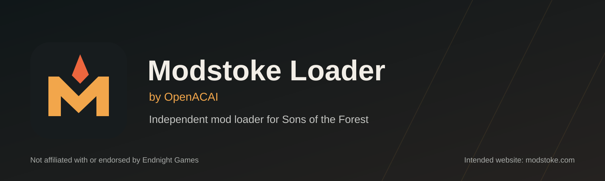

# Modstoke Loader



[](LICENSE)
[](https://store.steampowered.com/app/1326470/Sons_Of_The_Forest/)
[](docs/NET11_PREVIEW_EXPERIMENT.md)

Developer: Alex Cooper

Modstoke Loader by OpenACAI is an independent mod runtime for Sons of the Forest, published by OpenACAI, a nonprofit. It is not affiliated with or endorsed by Endnight Games.

This experimental branch targets `.NET 11 RC3`; the `.NET 10` LTS line remains on `openacai-net10-port`. BepInEx, RedLoader, and SonsSdk remain credited upstream projects and compatibility targets as the runtime and Modstoke SDK develop. Local RC3 builds are not a new signed public release.

This repo is public loader infrastructure only. It does not include Modstoke Admin or private companion modules.

Modstoke is the website/catalog name. Its intended address is `modstoke.com`; registration, HTTPS, and services are unconfirmed. Use the existing GitHub download and update links below.

Owned assemblies and APIs now use `Modstoke` namespaces with concise type names.
This is an unreleased, breaking source migration: rebuild mods against the matching
loader. The game-root folder is now `Modstoke\` (`Modstoke\Runtime`, `Modstoke\Mods`,
`Modstoke\UserData`). On first start the loader moves existing `OpenACAI\Mods` and
`OpenACAI\UserData` contents into it; the old `OpenACAI\Runtime` is no longer used.
Save formats, plugin IDs, `openacai*.json` file names, the `BepInEx\plugins\OpenACAILoader`
mirror and published download endpoints, including `OpenACAILoader.zip`, stay unchanged.

See [Branding and compatibility](docs/MODSTOKE_BRANDING.md) for the retained identifiers and coordination with the other Modstoke projects.

Upstream/fork lineage is documented in `UPSTREAMS.md`.

See `docs/NET11_PREVIEW_EXPERIMENT.md` for the RC2 build pins and compatibility limits before publishing packages from this branch.

Sons Of The Forest uses Unity `2022.2.16f1` in the current local install. Runtime dependency facts and the loader hardening roadmap are documented in `docs/SOTF_RUNTIME_COMPATIBILITY.md`.

The Modstoke SDK is documented in `docs/sdk.md`.

The runtime rewrite plan for replacing BepInEx/RedLoader-shaped internals with OpenACAI-owned modules and compatibility shims is documented in `docs/runtime.md`.

Repository layout, related public forks, and release boundaries are documented in `docs/PROJECT_STRUCTURE.md`.

See [Contributing](CONTRIBUTING.md) for code conventions and change guidance.

## Prebuilt Download

Use GitHub Releases for installable prebuilts instead of storing the loader ZIP in Git history:

- [Latest OpenACAILoader.zip](https://github.com/desertofunknown/openacai-loader/releases/latest/download/OpenACAILoader.zip)
- [Latest loader update and file hash manifest](https://github.com/desertofunknown/openacai-loader/releases/latest/download/OpenACAILoader.manifest.json)
- [Latest SHA256 checksum](https://github.com/desertofunknown/openacai-loader/releases/latest/download/OpenACAILoader.zip.sha256)

The `prebuilt/` folder is now only a small pointer/metadata area. The paired manager should install the release asset ZIP directly, and the manifest points at the latest release asset by default.

## What It Does

- Loads through an OpenACAI-owned Rust `winhttp.dll` native host, then enters the OpenACAI managed bootstrap. The default path now performs OpenACAI-owned preloader orchestration before invoking transitional BepInEx IL2CPP APIs as compatibility dependencies while the remaining preloader and chainloader internals are ported.
- Packages the .NET 11 RC3 CoreCLR hostfxr runtime layout. This active branch no longer tries to produce .NET 6 compatibility packages.
- Treats BepInEx plugins and RedLoader/SonsSdk mods as compatibility targets that OpenACAI absorbs, not as the long-term runtime foundation.
- Adds `Modstoke\Mods` as the native Modstoke package root while `Mods\` and
  `BepInEx\plugins\` remain legacy compatibility roots.
- Publishes OpenACAI runtime shim health for BepInEx plugins, RedLoader mods, and SonsSdk compatibility so companion tooling can see ready, warning, inventory-only, and failed states.
- Keeps `RedLoader.dll` and `SonsSdk.dll` available for binary compatibility while RedLoader behavior is reimplemented behind OpenACAI shims.
- Packages HarmonyX `2.16.1` with the .NET 11 MonoMod port:
  MonoMod.Core `1.3.5-openacai-net11.5`,
  MonoMod.RuntimeDetour `25.3.5-openacai-net11.5`, and MonoMod.Utils
  `25.0.13-openacai-net11.5`. Harmony-driven Sons menu patches are gated by
  dependency and IL2CPP hook health instead of running blindly during early
  startup.
- Adds a Modstoke SDK surface for loader state, scene classification, world entry/exit, pause menu state, and future source-like modding helpers.
- Moves loader UI keybinds and file-backed config parsing/saving into OpenACAI-owned services.
- Publishes mods menu and config UI surface state through an OpenACAI UI service for future companion/admin integrations.
- Builds toward OpenACAI-owned plugin discovery, interop repair, safe patch hosting, and native-style mod settings UI while moving Unity lifecycle dispatch out of the bootstrap adapter.
- Exposes a small `LoaderCapabilities` reflection surface for private companion/admin modules to identify loader mode, hosted mod count, startup health, and safe runtime paths without depending on private loader internals.
- Publishes a GitHub update manifest with SHA256 hashes for loader-owned files so Modstoke Manager can verify, repair, and update the installed loader before launching the game.
- Writes a local mod inventory in the loader state file so manager and companion tooling can distinguish Modstoke-native packages, legacy RedLoader mods/libraries, legacy BepInEx plugins, and Vortex-owned packages.
- Writes loader, bootstrap, native-host, and chainloader boundary state after game startup:

```text
Modstoke\Runtime\openacai-loader-state.json
Modstoke\Runtime\openacai-chainloader-state.json
```

## Source Layout

Start with [Project Structure](docs/PROJECT_STRUCTURE.md) for module boundaries,
common edit locations, naming conventions and release boundaries.
The [documentation index](docs/README.md) groups the SDK and runtime guides by topic.

- [Native host](src/Modstoke.NativeHost/src/lib.rs): Rust startup boundary.
- [Bootstrap](src/Modstoke.Bootstrap/Entrypoint.cs): managed entry point.
- [Preloader](src/Modstoke.Preloader): interop generation and startup services.
- [Core guide](src/Modstoke.Loader/README.md): loader services and Sons-specific folders.
- [Plugin.cs](src/Modstoke.Loader/Plugin.cs): Core runtime entry point.
- [SDK workflow](docs/SDK_DEVELOPMENT_WORKFLOW.md): mod development and API navigation.
- [Source and Build](docs/NEXUS_SOURCE_AND_BUILD.md): build inputs and packaging.
- [Contributing](CONTRIBUTING.md): code conventions.

## Package Shape

`OpenACAILoader.zip` installs into the game root and contains:

- `winhttp.dll` from the Modstoke Native Host, `.doorstop_version`, and `doorstop_config.ini`.
- `dotnet\` .NET 11 RC3 hostfxr and CoreCLR runtime files for the transitional IL2CPP bootstrap.
- `BepInEx\core\`, `BepInEx\config\`, `BepInEx\patchers\`, and `BepInEx\unity-libs\`.
- `Modstoke\Runtime\` with the OpenACAI Doorstop bootstrap target, Modstoke Loader core, hostfxr runtime config, package manifest, bootstrap/chainloader/loader state files, and file hash manifest.
- `Modstoke\Runtime\Compatibility\` with legacy RedLoader/SonsSdk support assemblies and curated SDK-support dependencies while those APIs are absorbed into OpenACAI.
- An empty `Mods\` folder for RedLoader-compatible mods.
- `BepInEx\plugins\OpenACAILoader\` as a temporary bootstrap compatibility mirror for the current hostfxr/BepInEx bridge.

Generated cache, logs, BepInEx `interop`, mutable user config, and private/admin plugins are intentionally left out of the integrity manifest. Private/admin plugins are not included in this source repo or package recipe.

## Build A Local Zip

From this folder:

```powershell
.\build.ps1
```

The script expects a working Sons of the Forest install with the current transitional BepInEx/OpenACAI runtime files present, plus the RedLoader support assemblies used by the compatibility shim. By default it resolves the game root from this workspace layout; pass `-GameRoot "C:\path\to\Sons Of The Forest"` if needed.

Normal local package builds build the Modstoke Native Host, validate its
pinned `winhttp.dll` export surface with `llvm-readobj`, and reuse existing
BepInEx IL2CPP outputs when the required files are already present. Keep LLVM
tools on `PATH` so `lld-link.exe` and `llvm-readobj.exe` are available. Pass
`-UseDoorstopForkNativeHost` only when you intentionally want a comparison
package that uses the older UnityDoorstop fork output.

The default package keeps Windows x64 native runtime assets and prunes other
platform-native BepInEx runtime folders. Pass `-IncludeAllNativeRuntimeAssets`
only for an audit/source-trail package that needs every platform-native asset.

The package script prefers 7-Zip Deflate output when `7z`, `7zz`, or `7za` is
available, using maximum standard ZIP/Deflate settings
(`mx=9,mfb=258,mpass=15`), and falls back to PowerShell `Compress-Archive` if
not. Standard Deflate keeps the package readable by GitHub, Windows Explorer,
and the Modstoke Manager.

By default the script writes release-ready artifacts to `dist/` and does not
refresh the tracked `prebuilt/` folder:

```text
dist\OpenACAILoader.zip
dist\OpenACAILoader.manifest.json
dist\OpenACAILoader.zip.sha256
```

Upload those three files as GitHub Release assets. Use `-UpdatePrebuilt` only
for an intentional local/debug refresh of the tracked prebuilt area.

## Dependency Links

- Sons Of The Forest: `https://store.steampowered.com/app/1326470/Sons_Of_The_Forest/`
- BepInEx: `https://github.com/BepInEx/BepInEx`
- RedLoader/SonsSdk rewrite source: `https://github.com/ToniMacaroni/RedLoader/tree/rewrite`
- Modstoke Manager: `https://github.com/desertofunknown/openacai-mod-manager`

## Licensing

OpenACAI-authored loader code is licensed under `GPL-3.0-or-later`.

This project depends on, works with, and may redistribute components from:

- BepInEx by the BepInEx team, licensed under `LGPL-2.1`: `https://github.com/BepInEx/BepInEx`
- RedLoader/SonsSdk by Toni Macaroni, licensed under `LGPL-2.1` in the upstream repo license file: `https://github.com/ToniMacaroni/RedLoader`
- RedManager by Toni Macaroni, licensed under `Apache-2.0`, where manager references are relevant: `https://github.com/ToniMacaroni/RedManager`

See `THIRD_PARTY_NOTICES.md` and the `LICENSES` folder.


